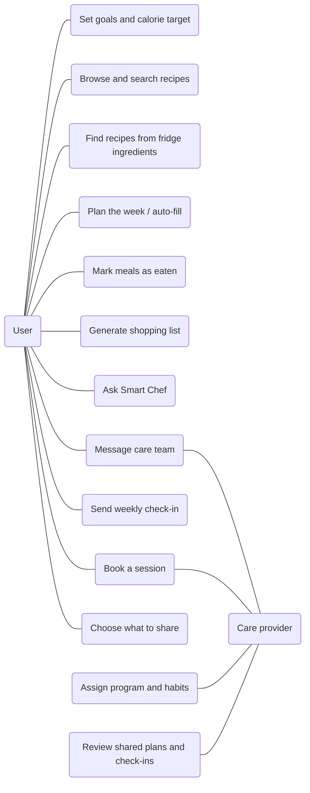
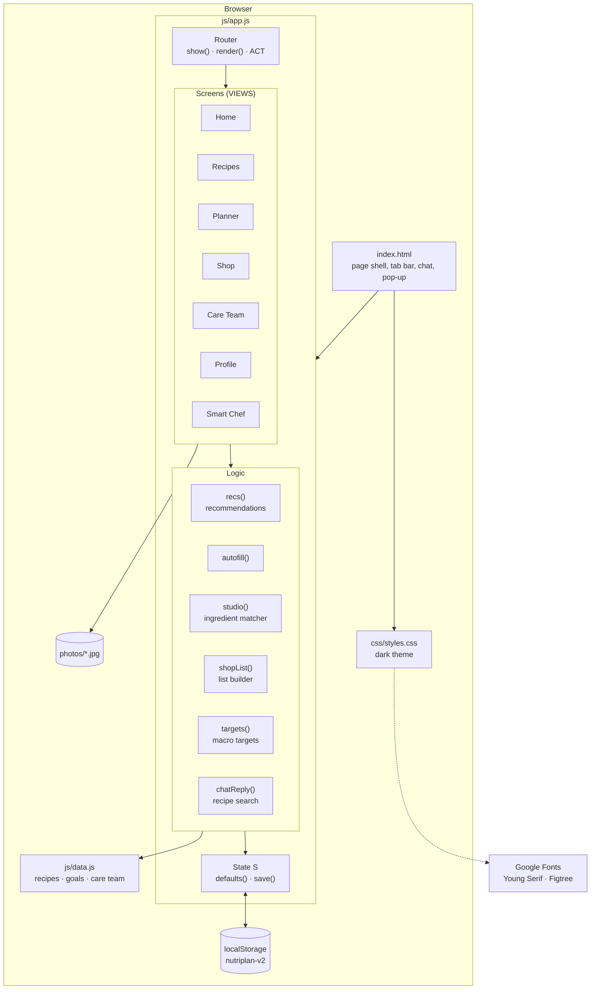
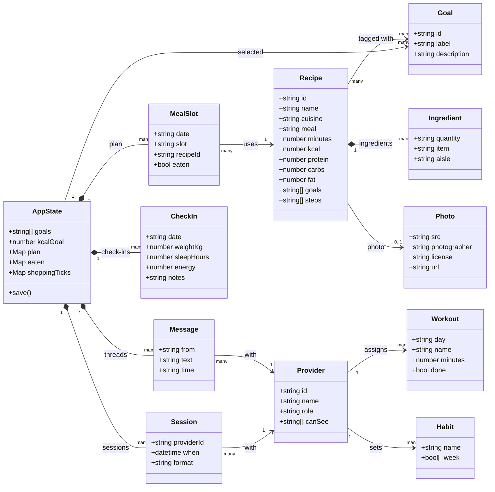
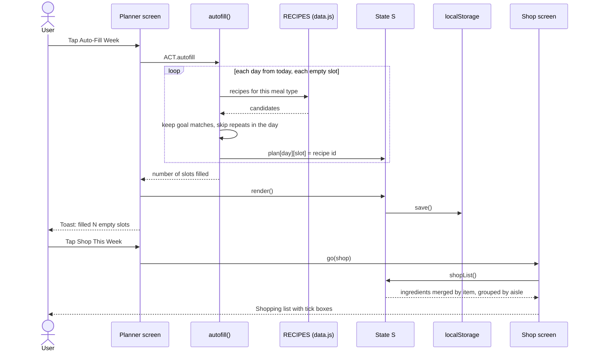
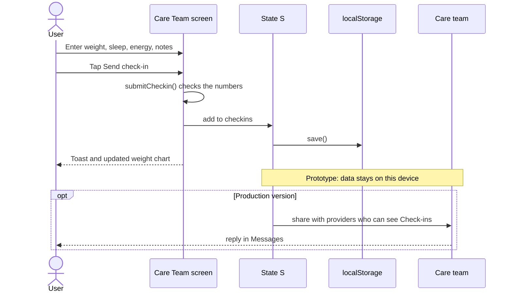
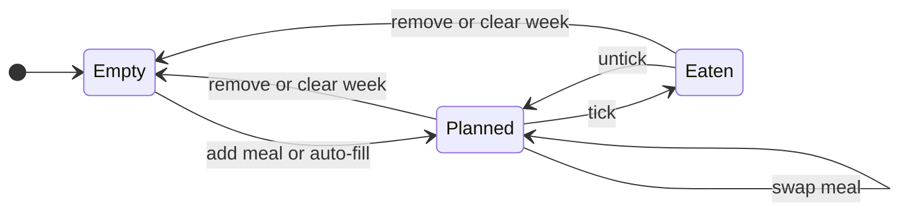
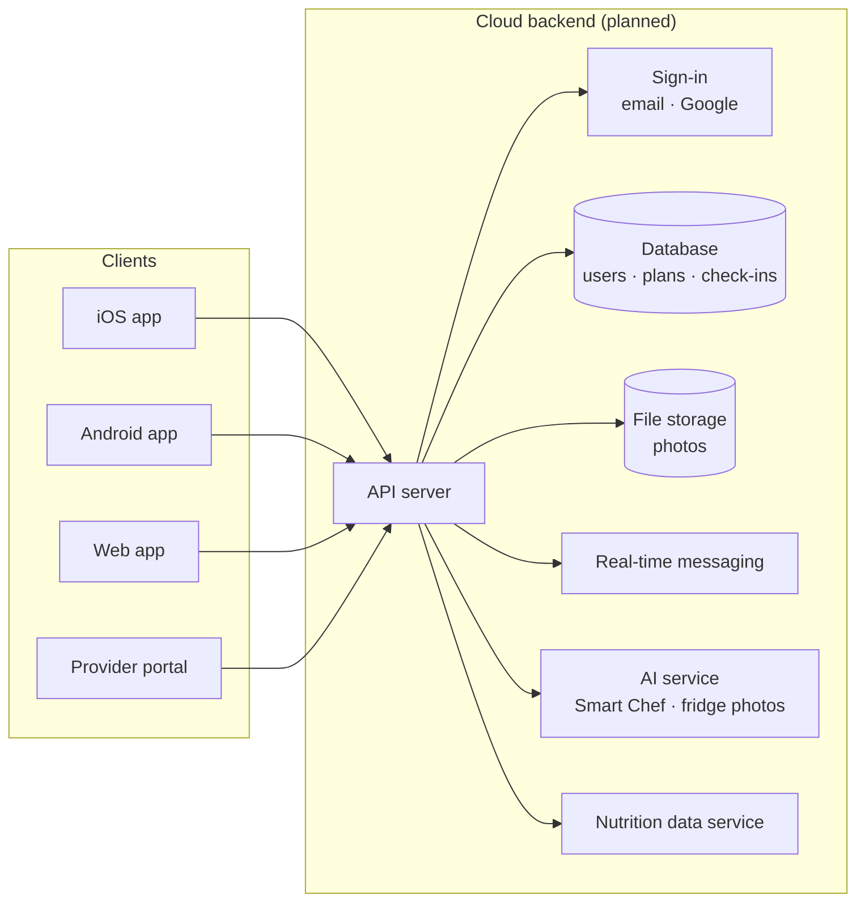

# NutriPlan architecture

UML diagrams for the NutriPlan prototype. They render on GitHub and in VS Code's Markdown preview (with the recommended Mermaid extension). With `npm start` running, the same diagrams are at http://localhost:5173/docs/.

Sources live in `docs/uml/*.mmd`. After editing one, run `npm run uml` to refresh the SVG images.

## Contents

1. [Who does what](#who-does-what)
2. [Components in the browser](#components-in-the-browser)
3. [Data model](#data-model)
4. [Auto-fill the week, then shop](#auto-fill-the-week-then-shop)
5. [Weekly check-in](#weekly-check-in)
6. [Life of a meal slot](#life-of-a-meal-slot)
7. [Planned production setup](#planned-production-setup)

## Who does what

*Use case diagram.* The two actors: users plan, shop and track; care providers message, assign programs and review what users share.

## Components in the browser

*Component diagram.* index.html loads app.js, which holds the router, the screens, the logic functions and the saved state. Content comes from data.js; state is saved in localStorage.

## Data model

*Class diagram.* Recipes own their ingredients and point to an optional photo and to health goals. The app state holds the meal plan, check-ins, sessions and message threads with providers.

## Auto-fill the week, then shop

*Sequence diagram.* Auto-fill walks each empty slot from today, picks goal-matching recipes without repeats in a day, saves the plan, and the shopping list is built from it.

## Weekly check-in

*Sequence diagram.* A check-in is validated, saved and charted. In production it would also be sent to the providers the user lets see check-ins.

## Life of a meal slot

*State diagram.* A slot starts empty, becomes planned when a recipe is added, can be marked eaten, swapped or removed, and resets when the week is cleared.

## Planned production setup

*Deployment diagram.* Mobile, web and provider apps talk to one API, which handles sign-in, the database, photos, messaging, the AI assistant and nutrition data.

